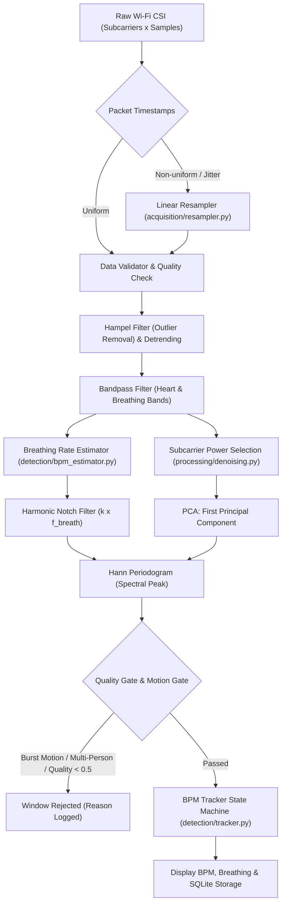

# Wi-Fi Heartbeat Tracker

[](https://github.com/kpranav1226-tech/wifi-heartbeat-tracker/actions/workflows/ci.yml)
[](https://www.python.org/)
[](LICENSE)
[](tests/)

Non-invasive desktop application and signal processing pipeline that estimates heart rate (BPM) and breathing rate from Wi-Fi Channel State Information (CSI) radio frequency fluctuations.

> [!CAUTION]
> **DISCLAIMER: NOT A MEDICAL DEVICE**
> This software is an experimental proof-of-concept for research and educational purposes only. It is **not** a certified medical diagnostic device. Readings are subject to RF interference, motion artifacts, multipath fading, and signal attenuation. The core pipeline is intentionally designed with conservative quality gates that **reject unreliable windows rather than display inaccurate estimates**.

---

## Key Features

- **Robust Signal Processing Pipeline:**
  - Automated detection and linear resampling of irregular/jittered packet arrival intervals.
  - Hampel filter for RF impulse noise removal + linear detrending.
  - Dynamic subcarrier power selection to filter out insensitive or dead subcarriers.
  - Breathing rate estimation and breathing harmonic notch rejection (orders 2–6) to prevent respiration harmonics from masking heartbeats.
  - Principal Component Analysis (PCA) across Wi-Fi subcarriers to extract the dominant chest-wall motion vector.
  - Spectral peak estimation using high-resolution Hann-windowed periodograms.
  - Multi-person detection using aggregate multi-subcarrier spectra.
  - Motion burst artifact gating based on high-frequency RMS energy ratios.
- **State-Machine BPM Tracker:**
  - Robust tracking states: `searching` → `tracking` → `holding` → `relocked` → `lost`.
  - Exponential smoothing with jump gating (outlier suppression) and automatic re-locking.
- **Interactive PySide6 Dashboard:**
  - Real-time animated waveform displays: Raw CSI amplitude, Heartbeat-band signal, and Power Spectral Density (PSD).
  - Multi-scenario RF simulator dropdown (`clean`, `noisy`, `strong_harmonics`, `motion`, `two_people`, `no_subject`, `packet_loss`).
  - Historical measurement viewer and SQLite database export to CSV.
- **Ground-Truth Evaluation Toolkit:**
  - Automated pairing of Wi-Fi readings against synchronized reference devices (e.g., pulse oximeters, ECG).
  - Calculates Mean Absolute Error (MAE), Root Mean Squared Error (RMSE), Pearson correlation ($r$), Bland–Altman bias, 95% Limits of Agreement (LoA), and agreement rates within $\pm 3$ and $\pm 5$ BPM.
  - Built-in SVG Bland–Altman chart generator.
- **Hardware Agnostic:**
  - Clean abstract base class (`HardwareCSISource`) to plug in live CSI streams from ESP32, Intel 5300, Atheros, or Nexmon.

---

## Signal Processing Pipeline



---

## Installation

### Prerequisites
- Python 3.10, 3.11, or 3.12
- Git

### 1. Clone the repository
```bash
git clone https://github.com/kpranav1226-tech/wifi-heartbeat-tracker.git
cd wifi-heartbeat-tracker
```

### 2. Create and activate a virtual environment
- **Windows (PowerShell):**
  ```powershell
  python -m venv .venv
  .\.venv\Scripts\Activate.ps1
  ```
- **macOS / Linux:**
  ```bash
  python3 -m venv .venv
  source .venv/bin/activate
  ```

### 3. Install dependencies
```bash
pip install -r requirements.txt
```

---

## Usage

### 1. Graphical Dashboard (GUI)
Launch the interactive PySide6 dashboard:
```bash
python main.py
```
Inside the dashboard:
- Adjust simulated true BPM (45–130 BPM).
- Switch scenarios: `clean`, `noisy`, `strong_harmonics`, `motion`, `two_people`, `no_subject`, `packet_loss`.
- Click **Start simulation** to watch real-time tracking, breathing estimates, and spectral peaks.
- Click **History / export** to review stored SQLite measurements or export up to 10,000 records to CSV.

### 2. Headless CLI Mode
Run in terminal mode on synthetic or captured CSI:
```bash
python main.py --cli --bpm 72 --seed 1
```
Output:
```text
True BPM:      72.0
Estimated BPM: 72.0
Quality:       1.00  accepted=True
```

### 3. Custom Configuration
Override defaults using a JSON file:
```bash
python main.py --config config.example.json --verbose
```
Example configuration (`config.example.json`):
```json
{
  "sample_rate_hz": 100.0,
  "window_seconds": 30.0,
  "n_subcarriers": 30,
  "heart_band_hz": [0.7, 2.2],
  "breath_band_hz": [0.1, 0.5],
  "max_breath_harmonic": 6,
  "max_gap_s": 0.5,
  "min_quality": 0.5
}
```

### 4. Running the Accuracy Benchmark
Evaluate performance across all simulator scenarios:
```bash
python benchmark.py --trials 30
```
Example results:
```text
scenario            accepted     MAE  false accepts
clean                   80%    0.06              0
noisy                  100%    0.10              0
strong_harmonics        20%    0.08              0
motion                   0%       -              0
two_people               0%       -              0
no_subject               0%       -              0
packet_loss            100%    0.69              0
```
*Note: False accepts (estimating a BPM when no subject is present or deviating by > 3 BPM) are strictly minimized to zero.*

---

## Ground-Truth Comparison (e.g. Pulse Oximeter)

To evaluate estimates against a reference medical pulse oximeter or ECG logger:

1. **Export the tracker log to CSV:**
   ```bash
   python -m evaluation.export_db data/heartbeat.db wifi_bpm.csv
   ```
2. **Format your reference log:**
   Prepare a CSV containing timestamp and BPM columns (ISO-8601 or Unix seconds):
   ```csv
   timestamp,bpm
   2026-11-07T12:00:00+00:00,72.0
   ```
3. **Run comparative evaluation:**
   ```bash
   python -m evaluation.compare wifi_bpm.csv pulse_oximeter.csv --output-csv results/evaluation.csv --tolerance 5 --offset 0
   ```
The tool prints summary metrics:
```text
Tracker rows:        150  (accepted 142, coverage 95%)
Reference readings:  150
Paired readings:     142
Bias (tracker - ref): +0.12 BPM
MAE:                  0.85 BPM
RMSE:                 1.15 BPM
95% limits of agreement: -2.13 to +2.37 BPM
Within +/-3 BPM:      98%
Within +/-5 BPM:      100%
Correlation (r):      0.978
```

---

## Connecting Real Wi-Fi Hardware

To use real Wi-Fi hardware instead of the simulator, implement the `HardwareCSISource` interface in [`acquisition/csi_loader.py`](acquisition/csi_loader.py):

```python
from acquisition.csi_loader import HardwareCSISource
from core.data_models import CSIRecording

class MyESP32CSISource(HardwareCSISource):
    def read_stream(self):
        # Read UDP / Serial packets from ESP32 / Intel 5300
        # Yield CSIRecording windows
        pass
```

Hardware options commonly used with CSI sensing:
- **ESP32**: ESP32-CSI-Tool (802.11n subcarriers via promiscuous mode or ping)
- **Intel 5300 NIC**: Linux 802.11n CSI Tool (30 subcarriers)
- **Atheros AR9300 / AR9580**: Atheros CSI Tool (56 subcarriers)
- **Broadcom / Cypress**: Nexmon CSI Tool

---

## Testing

Run the full pytest suite (48 tests covering data validation, packet resampling, tracking state machine, spectral estimation, pipeline, storage, Bland–Altman comparison, and scenarios):

```bash
pytest -v
```

---

## Project Structure

```text
wifi-heartbeat-tracker/
├── .github/workflows/ci.yml       # GitHub Actions CI workflow
├── acquisition/
│   ├── csi_loader.py              # File loader and HardwareCSISource base class
│   ├── data_validator.py          # Recording integrity & timestamp checks
│   ├── resampler.py               # Non-uniform packet arrival resampling
│   └── simulator.py               # Synthetic CSI generator with multi-case scenarios
├── core/
│   ├── config.py                  # Dataclass configuration with JSON loading
│   └── data_models.py             # CSIRecording and BPMResult structures
├── database/
│   └── storage.py                 # SQLite measurement logging and export
├── detection/
│   ├── bpm_estimator.py           # Spectral periodogram & breath harmonic exclusion
│   ├── heartbeat_extractor.py     # Bandpass filtering & PCA subcarrier extraction
│   ├── quality_assessor.py        # Peak ratio, motion detection, and multi-person gates
│   └── tracker.py                 # State-machine BPM tracker (searching/tracking/lost)
├── evaluation/
│   ├── compare.py                 # Ground-truth comparison and Bland-Altman stats
│   ├── export_db.py               # Database to CSV exporter
│   └── plotting.py                # Standalone SVG Bland-Altman chart generator
├── interface/
│   ├── dashboard.py               # PySide6 GUI dashboard
│   ├── history_view.py            # SQLite measurement history viewer
│   └── signal_graph.py            # PyQtGraph real-time signal visualizer
├── processing/
│   ├── denoising.py               # Detrending, PCA, and subcarrier selection
│   ├── filtering.py               # Butterworth bandpass and Hampel filter
│   └── normalisation.py           # Z-score normalization
├── tests/                         # Comprehensive unit & integration test suite (48 tests)
├── tracking/
│   └── bpm_smoother.py            # Rolling-median tracker alternative
├── benchmark.py                   # Simulator scenario accuracy benchmark
├── config.example.json            # Example configuration file
├── CONTRIBUTING.md                # Contribution guidelines
├── LICENSE                        # MIT License
├── main.py                        # Entry point (GUI and CLI modes)
├── pyproject.toml                 # Modern Python packaging metadata
├── pytest.ini                     # Pytest configuration
└── requirements.txt               # Python package dependencies
```

---

## License

This project is licensed under the [MIT License](LICENSE).
